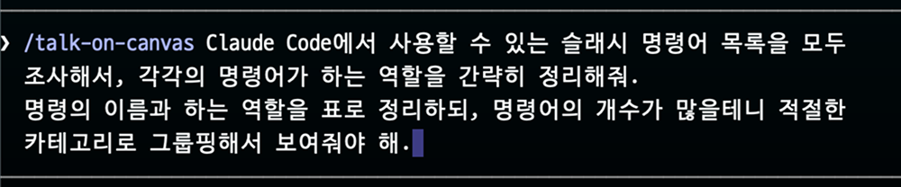
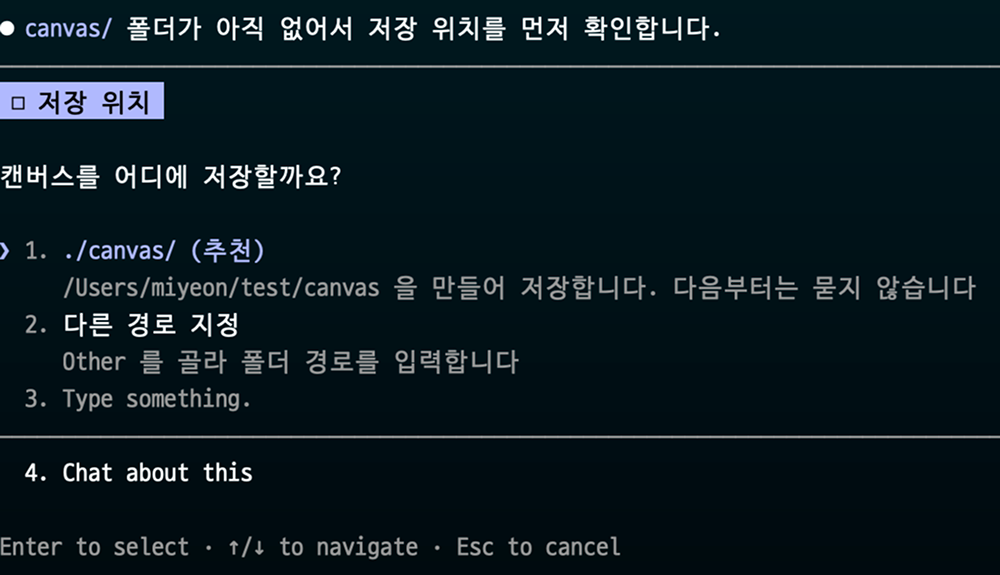
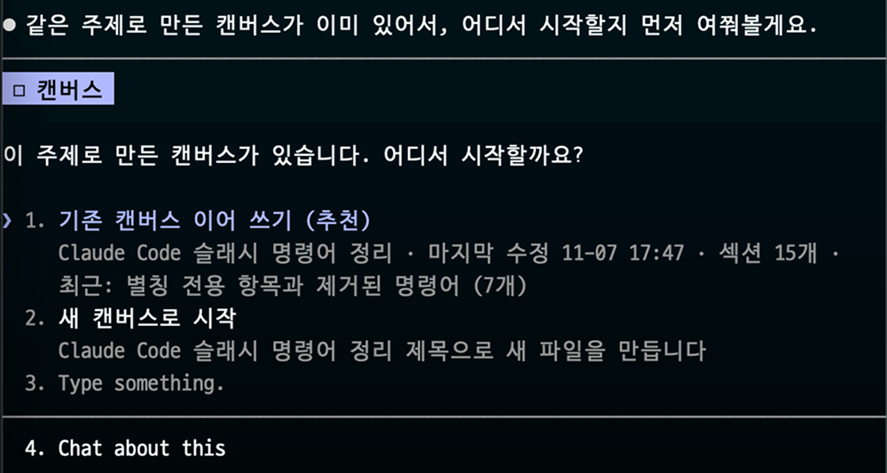
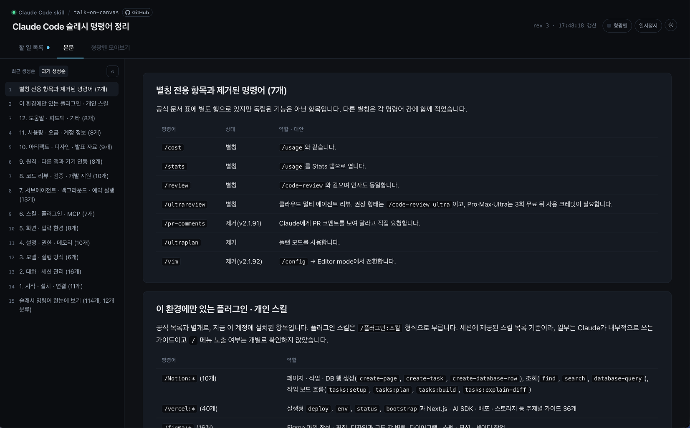
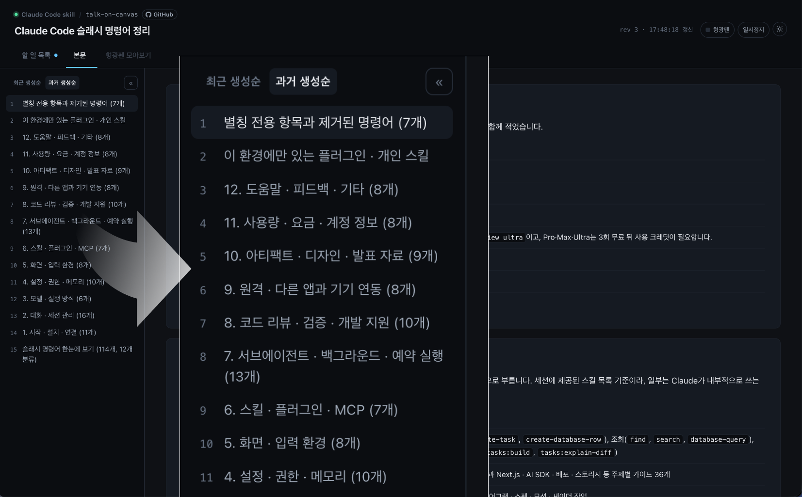
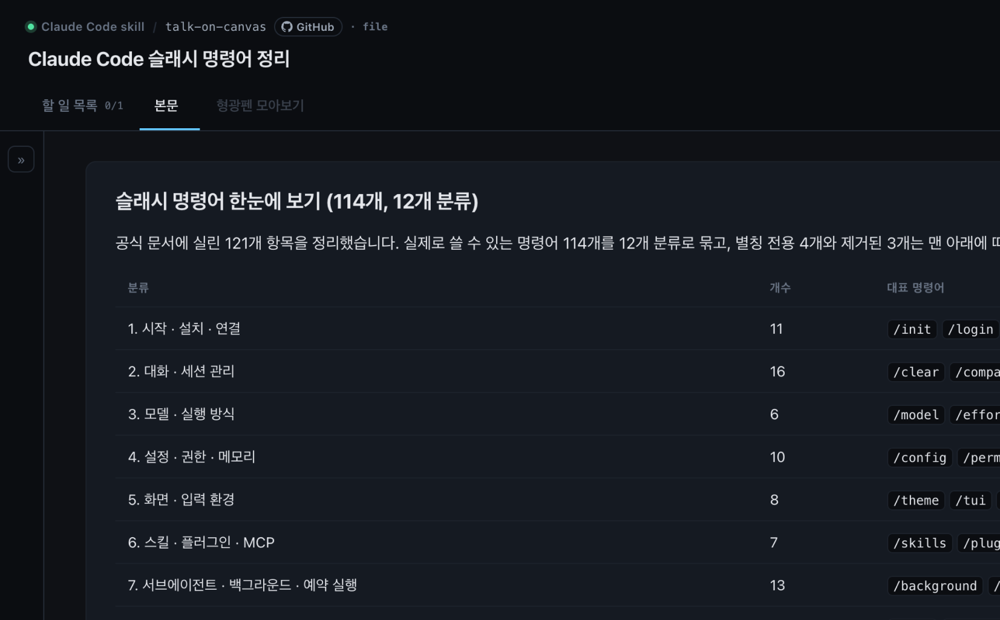
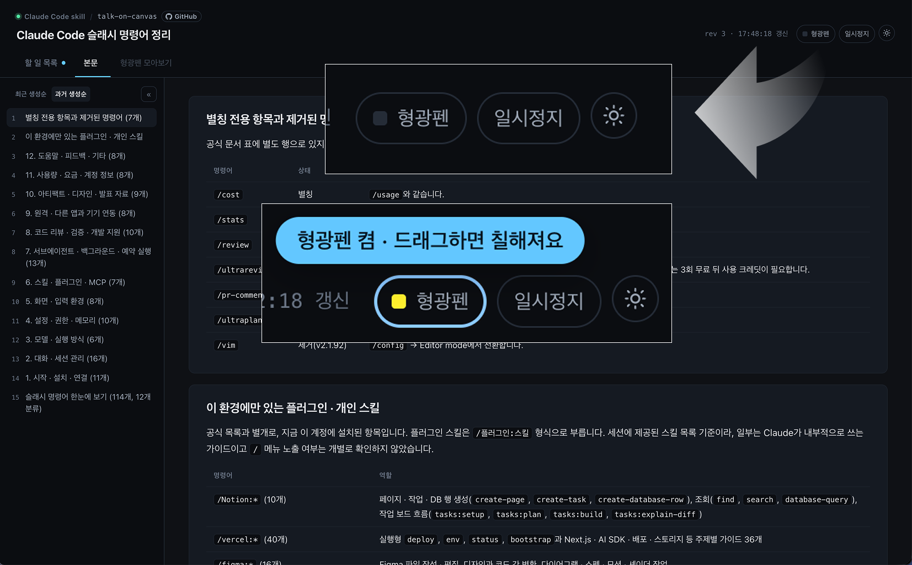
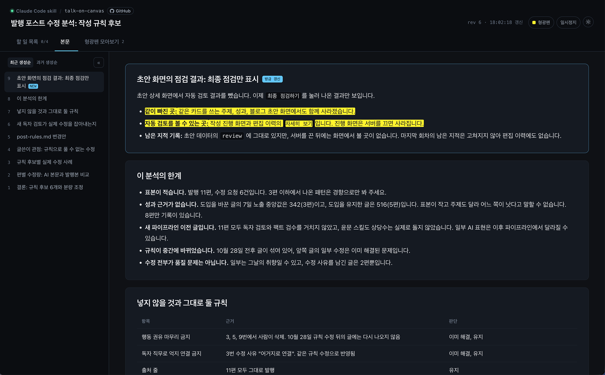
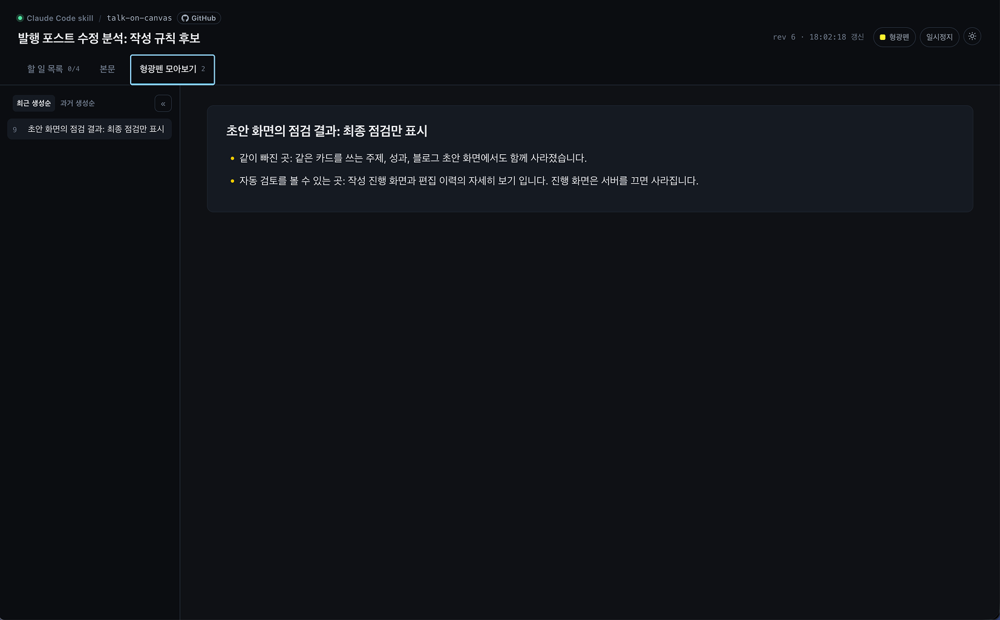
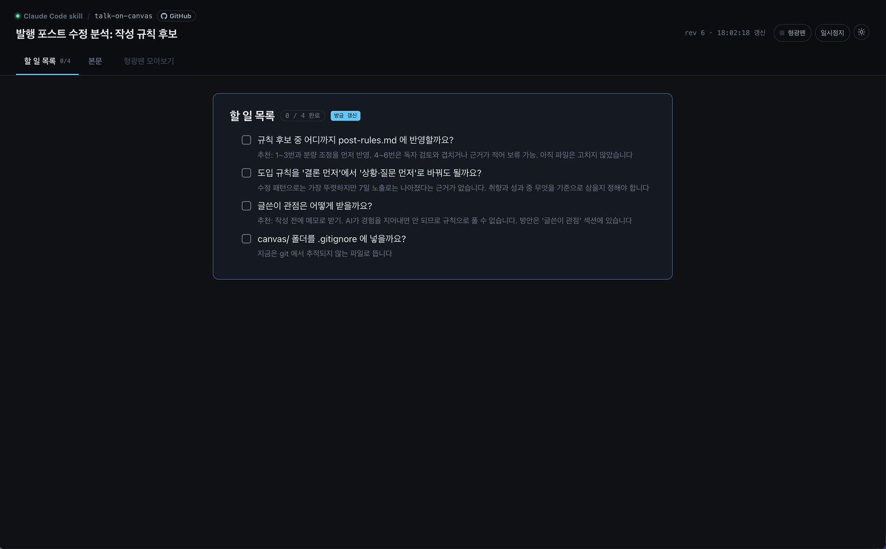

# talk-on-canvas

[한국어](README.md) · [English](README.en.md)

- A plugin that turns what the LLM produces while you work with it into a web page you can actually read.
- It is not a plugin for building web pages, and it does not just save results as an HTML file. Working with an LLM rarely ends with a single prompt. It takes follow-up questions, extra requests, and rounds of revision. Following all of those intermediate steps across a pile of .md files or a terminal window is hard to read. The goal of this plugin is to compress one conversation into one web page, so you can see it at a glance and keep a record of it.

### Supported LLMs

- Claude Code

## Usage

### 1. Invoke the plugin with the slash command and describe what you want to work on.



- So that you only work on a canvas when you want to, **the plugin runs only from the slash command**. Natural-language invocation ("let's use a canvas", "summarize this") is not supported.
- The canvas follows the language of your prompt. Write in English and the canvas UI and content are in English. It never asks you which language to use.

### 2. If there's no folder for canvases yet, it asks where to save them.



- By default it creates a folder named `canvas` and saves there, or you can specify a different path.



- If a canvas on the same topic already exists, it asks whether to continue in that canvas.

### 3. The canvas is created and your browser opens automatically.



- From then on, **you see every result of the conversation on the canvas.**
- The terminal only shows a very short note on what changed. Everything else is on the canvas in your browser.

## Layout

### (1) Table of contents



- The canvas is split into a table of contents on the left and the results on the right.
- The table of contents is sorted **newest first** by default, and you can switch it to oldest first.



- You can collapse the table of contents to give the content more room.

### (2) Highlighting



- Click the highlighter button at the top right to turn on **highlighter mode**.



- While highlighter mode is on, drag over any text to highlight it.



- Everything you highlighted is collected in the **Highlights** tab.

### (3) To-do list



- While producing results, the AI decides on its own what counts as a to-do and records it in the **To-do list** tab.
- Done and blocked states are kept up to date as the conversation goes on.

## Customizing the plugin

- Installed location: `~/.claude/plugins/cache/talk-on-canvas/talk-on-canvas/` (if you've changed `CLAUDE_CONFIG_DIR`, it's under that path instead).

### HTML UI design

- Edit the `<style>` block in `skills/talk-on-canvas/template/canvas.html`.
- Colors are CSS variables on `:root`, and light/dark follows `prefers-color-scheme`.

### How much goes to the terminal

- The default is **a 2–4 line note on what changed, with all content on the canvas**.
- If you'd like summaries in the terminal too, edit the "터미널에 무엇을 쓰는가" (What goes in the terminal) section of `SKILL.md`.

### Turning off the to-do list

- Delete the "할 일 목록 운영" (Running the to-do list) section of `SKILL.md` and leave the template's `<!-- TODO -->` region empty. The to-do list then hides itself.

## Installation

```plain_text
/plugin marketplace add winter-blanket/talk-on-canvas
/plugin install talk-on-canvas@talk-on-canvas
```

## How it works

- A local HTTP server (`127.0.0.1`) serves the folder that holds the canvas file, and the browser compares `data-rev` values to detect updates.
- Without python3, or if no port can be bound, it falls back to `file://` mode and updates with full reloads. It never reloads while you're scrolling or selecting text (it waits until you've been idle for 5 seconds), and if nothing has changed it backs off from every 4 seconds up to every 60 seconds. Scroll position is restored per tab.
- A `<filename>.server` file (recording the pid and port) appears next to the canvas file and is removed when the server stops.

## Supported languages

- Korean, English
- There's no language setting. The plugin detects the language of the prompt you invoke it with and builds the canvas UI and content in that language.

## File structure

```plain_text
talk-on-canvas/
├── .claude-plugin/
│   ├── plugin.json
│   └── marketplace.json
├── skills/
│   └── talk-on-canvas/
│       ├── SKILL.md                 # The skill itself: canvas operating rules
│       ├── template/
│       │   └── canvas.html          # Canvas template (styles and script included)
│       └── scripts/
│           └── canvas.sh            # Create, list, resume canvases · local server · open browser
├── LICENSE
├── README.md
└── README.en.md
```

## License

MIT
