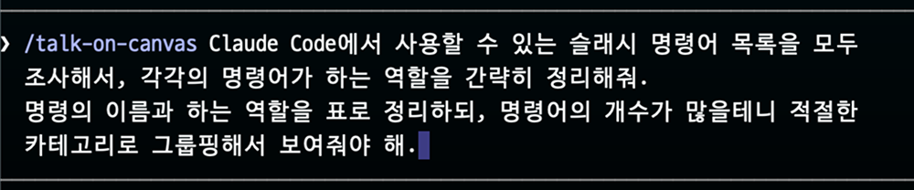
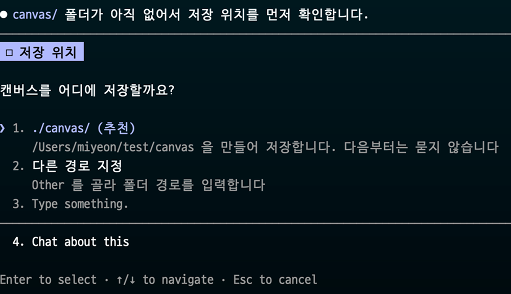
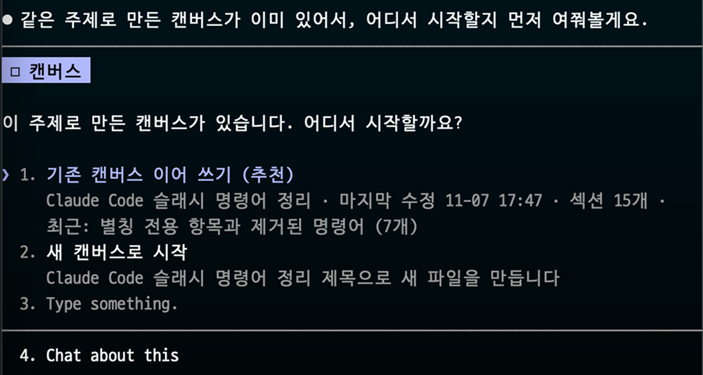
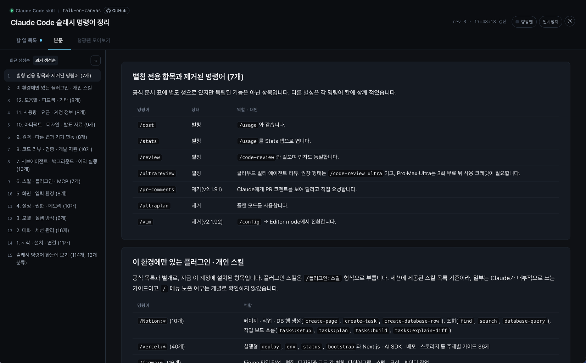
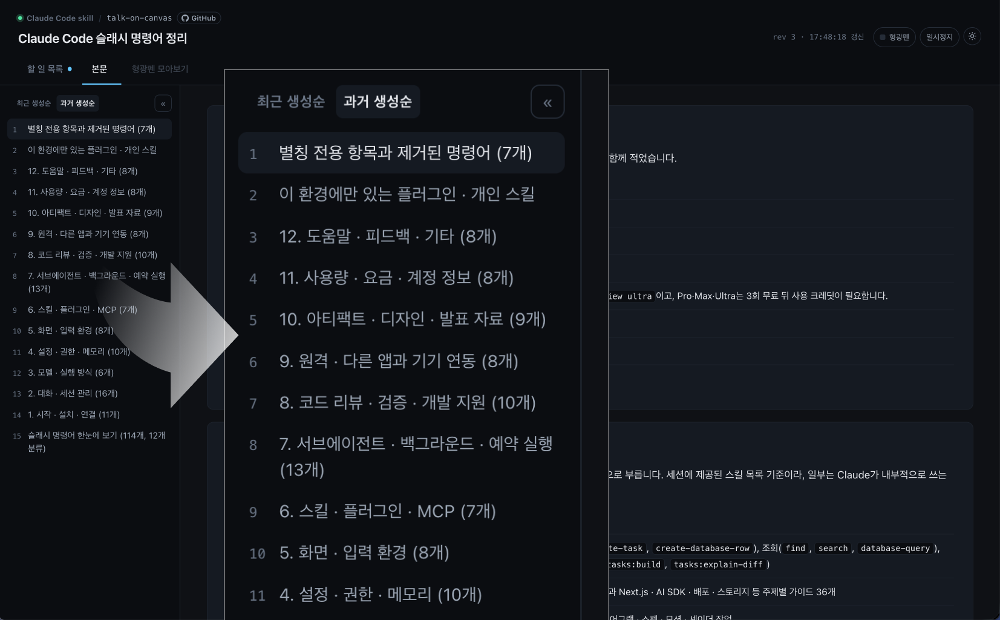
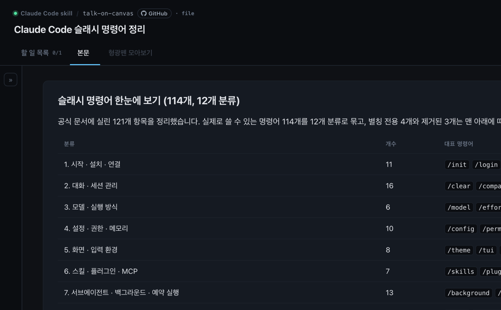
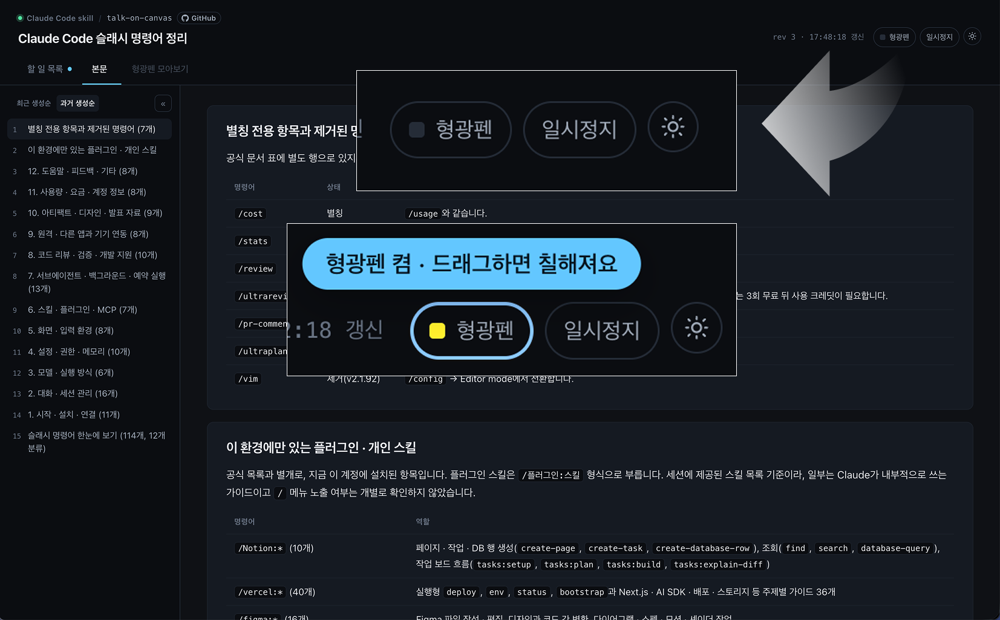
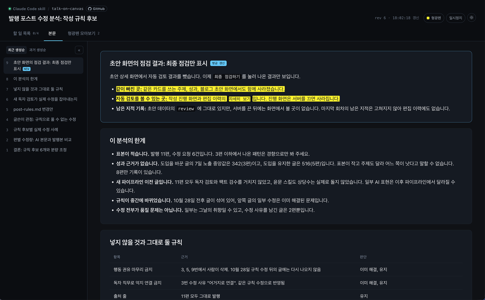
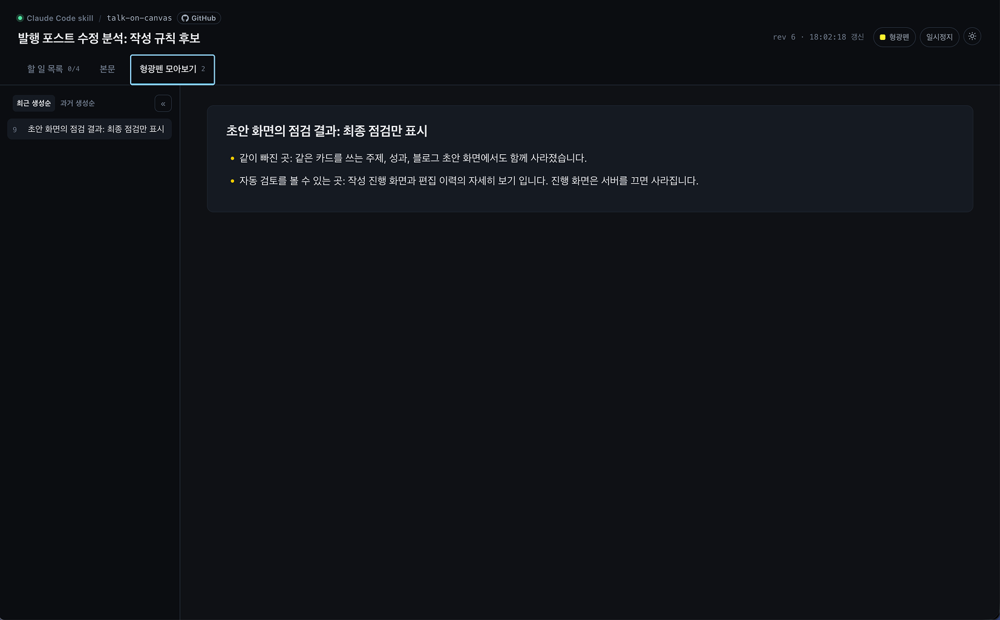
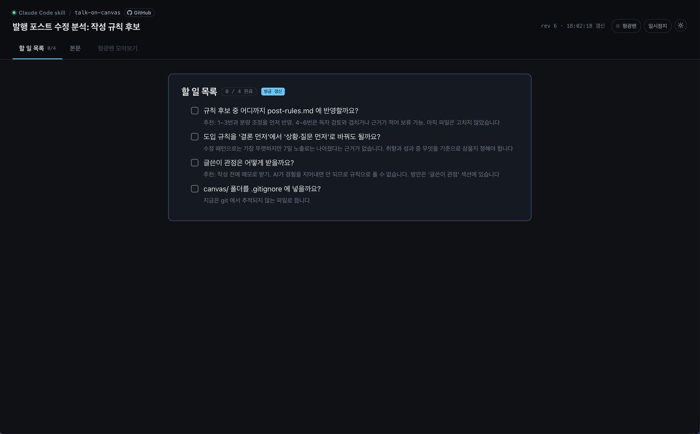

[l]()

# talk-on-canvas

[한국어](README.md) · [English](README.en.md)

- LLM과 대화하며 일할 때 LLM이 만든 산출물을 웹페이지로 시각화해서 보여주는 플러그인입니다.
- 웹페이지 개발이나, 단순히 결과물을 html 파일로 만드는 플러그인은 아닙니다. LLM과 일하는 과정은 보통 단 한번의 프롬프트로 끝나지 않습니다. 지속적인 질문, 추가 요청, 수정 작업을 거쳐 완성됩니다. 그 모든 중간 과정을 여러개의 .md 파일이나 터미널 화면으로 보는 것은 가독성이 떨어집니다. 이 플러그인의 목적은 하나의 대화 과정을 하나의 웹페이지로 압축해서 보고 기록을 남길 수 있도록 하는 데 있습니다.

### 지원하는 LLM

- Claude Code

## 사용법

### 1. 슬래시 명령어로 플러그인을 호출하면서 지금 하려는 작업을 설명해 주세요.



- 유저가 원할 때만 캔버스로 작업할 수 있도록, **슬래시 명령어로만 동작하게 제한되어 있습니다**. 자연어 호출("캔버스로 대화하자", "정리해줘")은 지원하지 않습니다.

### 2. 기존에 캔버스를 저장하던 경로가 없다면 어느 경로에 저장할지 확인합니다.



- 기본값으로`canvas`라는 이름의 폴더를 만들어 저장하거나, 특정 경로를 새로 지정할 수 있습니다. 



- 동일한 주제의 캔버스가 이미 있는 경우, 기존에 만들었던 캔버스에서 이어 진행할지 확인합니다.

### 3. 캔버스가 만들어지고 브라우저가 자동으로 열립니다.



- 이후 AI와 대화하며 만들어지는 **모든 결과를 캔버스로 확인합니다.**
- 터미널에는 "어디를 고쳤다"는 내용만 최대한 간략히 표시합니다. 모든 결과는 브라우저에서 캔버스 화면으로 확인합니다.

## 화면 구성

### (1) 목차



- 캔버스는 크게 좌측 목차 영역과 우측 결과 영역으로 구분됩니다.
- 목차는 **최근 생성순**이 기본값이며, 과거 생성순으로 바꿔 볼 수 있습니다.



- 목차를 접어서 본문을 더 넓게 볼 수도 있습니다.

### (2) 형광펜 메모하기



- 우측 상단 형광펜 버튼을 눌러서 **형광펜 모드**를 켭니다.



- 형광펜 모드가 켜져있을 때 원하는 부분을 드래그하면 형광펜 표시를 남길 수 있습니다.



- 표시해둔 문장은 **형광펜 모아보기** 메뉴에서 따로 모아볼 수 있습니다.

### (3) 할 일 모아보기



- AI가 산출물을 만드는 과정에서 알아서 '할 일' 거리를 찬단하고 **할 일 모아보기** 메뉴에 기록합니다.
- 완료·막힘 상태는 대화가 진행되면서 계속 갱신됩니다.

## 플러그인 커스텀하기

- 플러그인 설치 경로: `~/.claude/plugins/cache/talk-on-canvas/talk-on-canvas/` (`CLAUDE_CONFIG_DIR`를 바꿔 쓰고 있다면 그 경로 아래입니다.)

### html UI 디자인

- `skills/talk-on-canvas/template/canvas.html` 의 `<style>` 블록을 고치면 됩니다.
- 색은 `:root` 의 CSS 변수로 모여 있고, 라이트/다크는 `prefers-color-scheme` 로 결정됩니다.

### 터미널에 표시하는 분량

- 기본값은 **수정한 파트 요약 2~4줄, 내용은 전부 캔버스**입니다.
- 터미널에도 요약을 받고 싶으면 `SKILL.md` 의 「터미널에 무엇을 쓰는가」 절을 고치세요.

### 할 일 목록 끄기

- `SKILL.md` 의 「할 일 목록 운영」 절을 지우고, 템플릿의 `<!-- TODO -->` 영역을 비워 두면 자동으로 숨겨집니다.

## 플러그인 설치

```plain_text
/plugin marketplace add winter-blanket/talk-on-canvas
/plugin install talk-on-canvas@talk-on-canvas
```

## 동작 방식

- 로컬 HTTP 서버(`127.0.0.1`)가 캔버스 파일이 있는 폴더를 서빙하고, 브라우저가 `data-rev` 값을 비교해 갱신을 감지합니다.
- python3가 없거나 포트를 잡지 못하면 `file://` 모드로 떨어져 통째 새로고침으로 갱신합니다. 스크롤·선택 중에는 새로고침하지 않고(5초 손을 놓으면 실행), 내용이 그대로면 주기를 4초에서 최대 60초까지 늘립니다. 스크롤 위치는 탭별로 복원됩니다.
- 캔버스 파일 옆에 `<파일명>.server` (pid·포트 기록)가 생기고, 서버를 내리면 지워집니다.

## 지원 언어

- 한국어, 영어
- 언어를 따로 고르지 않습니다. 플러그인을 호출할 때 쓴 프롬프트의 언어를 감지해 캔버스 화면과 내용을 그 언어로 만듭니다.

## 파일 구조

```plain_text
talk-on-canvas/
├── .claude-plugin/
│   ├── plugin.json
│   └── marketplace.json
├── skills/
│   └── talk-on-canvas/
│       ├── SKILL.md                 # 스킬 본문 — 캔버스 운영 규칙
│       ├── template/
│       │   └── canvas.html          # 캔버스 템플릿 (스타일·스크립트 포함)
│       └── scripts/
│           └── canvas.sh            # 캔버스 생성·목록·이어 열기 · 로컬 서버 · 브라우저 열기
├── LICENSE
├── README.md
└── README.en.md
```

## 라이선스

MIT
